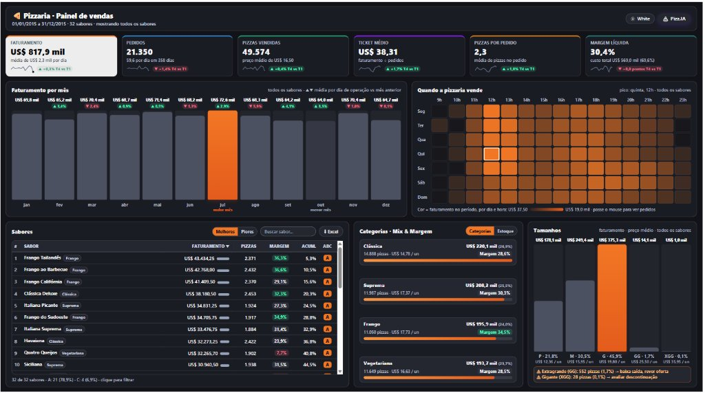
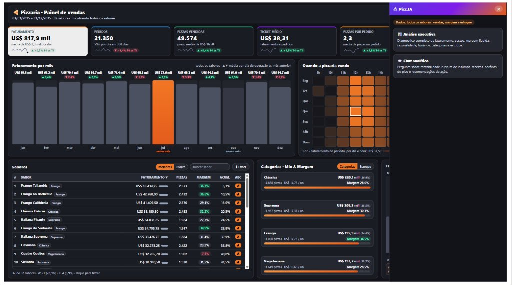

# 🚀 VA Studio — Visual Personalizado para Power BI (HTML, CSS & JavaScript)

Visual personalizado (`.pbiviz`) para o **Power BI Desktop e Power BI Service** que renderiza telas completas em **HTML5 + CSS3 + JavaScript** a partir de uma medida DAX, com suporte a **filtro cruzado bidirecional com a página (`pbi.filtrar`)**, download de arquivos e **análise executiva com IA Gemini (`pbi.perguntarIA`)**.

---

## 📦 Como Instalar no Power BI em 1 Minuto

1. Baixe o arquivo compilado pronto para uso:
   👉 **[`dist/vaStudio.pbiviz`](dist/vaStudio.pbiviz)**
2. No **Power BI Desktop**, vá no painel de **Visualizações**:
   * Clique nos três pontinhos (**`...`**) > **Importar um visual de um arquivo**.
   * Selecione o arquivo `vaStudio.pbiviz`.
3. O ícone do **VA Studio** aparecerá no seu painel de visuais pronto para ser adicionado a qualquer página!

> ℹ️ **O VA Studio não é certificado pela Microsoft nem está na AppSource**: ele é importado de arquivo. No Power BI Desktop funciona direto. No Power BI Service, o administrador do locatário pode bloquear visuais não certificados ou importados de arquivo; se o visual não carregar depois de publicar, é essa configuração que precisa ser verificada. Pela documentação da Microsoft, visuais não certificados também não são renderizados em exportações para PowerPoint nem em assinaturas por e-mail.

---

## 💡 Por que usar o VA Studio?

O visual *HTML Content* (de terceiros, disponível na AppSource) exibe apenas HTML/CSS estático e **não executa scripts JavaScript**.

Com o **VA Studio**, sua medida DAX ganha vida e controle total da página:

| Funcionalidade | HTML Content | VA Studio |
| :--- | :---: | :---: |
| **Renderização HTML5 e CSS3 moderno** | ✅ | ✅ |
| **Execução de JavaScript (`<script>`)** | ❌ | ✅ |
| **Filtro Cruzado com o Relatório (`pbi.filtrar`)** | ❌ | ✅ |
| **Persistência de Seleção ao Atualizar (`pbi.estado`)** | ❌ | ✅ |
| **Exportação / Download de Arquivos (`pbi.baixar`)** | ❌ | ✅ |
| **Análise em Tempo Real com IA Gemini (`pbi.perguntarIA`)** | ❌ | ✅ |

---

## 🖼️ Exemplo em Produção (`Power BI/Pizzaria.pbip`)

Projeto completo em formato **PBIP** já configurado no repositório com dados públicos em CSV e dashboard executivo de página única construído com o **VA Studio** (alternância de tema **Black / White**, Curva ABC interativa, mapa de calor por dia × hora, visão de mix e estoque, exportação CSV e assistente analítico **Pizz.IA**).





### Como abrir o projeto de exemplo no Power BI Desktop
1. Clone ou baixe este repositório e abra o arquivo **[`Power BI/Pizzaria.pbip`](Power%20BI/Pizzaria.pbip)**.
2. As tabelas consomem diretamente os 6 CSVs públicos de [`Power BI/dados/`](Power%20BI/dados/) através do parâmetro `PastaDados` (`Web.Contents`).
3. Ao atualizar o modelo pela primeira vez, selecione o método de autenticação **Anônimo** para `raw.githubusercontent.com`.
4. *(Opcional)* Para habilitar a **Pizz.IA**, informe sua própria chave da API do Google Gemini em **Formatar > IA (Gemini) > Chave da API** (ou configure um Endpoint Customizado).

---

## 🛠️ Como Utilizar em um Relatório

1. Crie uma **Medida DAX** que retorne uma string contendo seu HTML, CSS e JavaScript.
2. Adicione o visual **VA Studio** na página do relatório.
3. Arraste a sua medida para o campo **HTML** do visual.

O visual redesenha a tela e executa os scripts de novo sempre que o HTML devolvido pela medida muda, por exemplo quando um filtro da página altera os números.

---

## 📚 Biblioteca Global `pbi` (JavaScript)

Dentro da tag `<script>` da sua medida, o objeto global `pbi` já está disponível:

### 1. `pbi.filtrar(valores, tabela?, coluna?)`
Aplica filtro cruzado em todos os outros visuais da página do Power BI.
```javascript
// Filtra a dimensão dCliente pela coluna NomeCliente
pbi.filtrar(['Cliente Exemplo'], 'dCliente', 'NomeCliente');

// Filtro múltiplo
pbi.filtrar(['Região A', 'Região B'], 'dRegiao', 'NomeRegional');
```
Se você chamar `pbi.filtrar(valores)` sem `tabela` e `coluna`, o visual usa o que estiver em **Formatar > Filtro**. Esses campos vêm vazios: preencha-os ou passe os dois argumentos, senão o visual mostra "Filtro não configurado".

### 2. `pbi.limpar()`
Remove o filtro aplicado pelo visual, restaurando o contexto original do relatório.
```javascript
pbi.limpar();
```

### 3. `pbi.estado`
Objeto de memória que sobrevive às atualizações de filtro do relatório (ideal para guardar itens selecionados ou paginação).
```javascript
// Salva o item selecionado
pbi.estado = { clienteSelecionado: 'Cliente ABC' };

// Ao recarregar a tela, lê o item gravado
var selecionado = pbi.estado.clienteSelecionado;
```

### 4. `pbi.baixar(conteudo, nomeArquivo, tipo?)`
Salva um arquivo pelo serviço de download do Power BI. O `tipo` é o tipo de arquivo que o Power BI espera (`'csv'` é o padrão; também `'txt'`, `'json'`...), **não** um MIME type como `text/csv`.
```javascript
var csv = 'Cliente;Venda\nCliente A;1500\nCliente B;2300';
pbi.baixar(csv, 'relatorio-clientes.csv', 'csv').then(function(ok) {
    if (!ok) {
        // Download bloqueado ou cancelado: ofereça outra saída (ex.: copiar e colar)
    }
});
```
A chamada devolve uma `Promise<boolean>`: `false` quando o download não aconteceu. No Power BI Service, ele depende da opção de administrador **Permitir downloads de visuais personalizados**.

### 5. `pbi.perguntarIA(prompt, opcoes?)`
Consulta a IA Gemini em tempo real enviando os indicadores da página.

**Antes de usar, configure a chave.** A IA não funciona sem uma chave da API do Gemini (crie a sua no Google AI Studio):

1. Selecione o visual **VA Studio** na página.
2. Abra o painel **Formatar** > **IA (Gemini)**.
3. Cole a chave em **Chave da API (Gemini / Token)**.

Sem a chave, `pbi.perguntarIA` rejeita a Promise com erro. Use `pbi.iaConfigurada()` para checar antes de chamar.

```javascript
pbi.perguntarIA('Analise estes indicadores e resuma os principais riscos: ' + dadosContexto)
   .then(function(resposta) {
       // A resposta é texto: use textContent, não innerHTML
       document.getElementById('parecer').textContent = resposta;
   })
   .catch(function(erro) {
       document.getElementById('parecer').textContent = 'Erro ao consultar a IA: ' + erro.message;
   });
```

O segundo argumento é opcional e aceita estas opções:

| Opção | O que faz |
| :--- | :--- |
| `dados` | Objeto ou texto anexado ao prompt como contexto do painel. |
| `instrucao` | Instrução de sistema (substitui a de **Formatar > IA (Gemini)**). |
| `modelo` | Modelo Gemini a usar. Se ele estiver indisponível, o visual tenta outros modelos Flash automaticamente. |
| `temperatura` | Criatividade da resposta (padrão `0.2`). |
| `json` | `true` pede a resposta em JSON. |

```javascript
pbi.perguntarIA('Resuma os principais riscos em 3 tópicos.', {
    dados: { faturamento: 1500, meta: 2000 },
    temperatura: 0.2
});
```

> ⚠️ **A chave fica gravada no relatório** e é enviada pelo navegador de quem o abre. Quem tem acesso ao relatório consegue lê-la. Para relatórios compartilhados, preencha **Endpoint Customizado** com um serviço seu (proxy) que guarde a chave no servidor: o visual envia um `POST` em JSON (`prompt`, `textoCompleto`, `dados`, `instrucao`, `modelo`, `temperatura`, `json`) e lê a resposta nos campos `resposta`, `text` ou `output`. Veja também [Segurança e Privacidade](#-segurança-e-privacidade).

### 6. Outros recursos

| Recurso | O que faz |
| :--- | :--- |
| `pbi.iaConfigurada()` | Devolve `true` se há chave ou endpoint preenchido em **Formatar > IA (Gemini)**. |
| `pbi.usoIA` | Consumo da IA na sessão: `ultimoTotalTokens`, `tokensAcumulados`, `requisicoesTotal` e uso por modelo em `modelos`. |
| `pbi.abrirLink(url)` | Abre um endereço pelo mecanismo de links do Power BI. |
| `pbi.largura` / `pbi.altura` | Tamanho atual do visual, em pixels. |
| `pbi.aoRedimensionar(fn)` | Registra uma função chamada quando o visual muda de tamanho. O evento `pbi-resize` na `window` avisa a mesma coisa. |
| `pbi.versao` | Versão do visual carregado no relatório (ex.: `'1.1.1.0'`). |

### Painel Formatar

| Cartão | Campos |
| :--- | :--- |
| **Filtro** | **Tabela** e **Coluna** usadas por `pbi.filtrar(valores)` quando o JS não informa as duas. Vêm vazias. |
| **IA (Gemini)** | **Chave da API**, **Modelo Gemini**, **Endpoint Customizado** (opcional) e **Instrução de Sistema**. |

---

## 📁 Modelos Prontos para Copiar e Colar (`exemplos/`)

Na pasta **[`exemplos/`](exemplos/)** você encontra códigos DAX prontos. Eles usam nomes de um modelo fictício (`[Total Vendas]`, `fVendas`, `dCliente[NomeCliente]`...): cada arquivo traz no topo o bloco **O QUE TROCAR**, com os nomes que você precisa substituir pelos do seu modelo.

* **[`01-card-kpi-executivo.dax`](exemplos/01-card-kpi-executivo.dax)**: Cartão executivo moderno com valor principal, meta, percentual de atingimento e barra de progresso responsiva.
* **[`02-tabela-com-busca-e-filtro.dax`](exemplos/02-tabela-com-busca-e-filtro.dax)**: Ranking dos 50 maiores clientes com campo de pesquisa em tempo real e clique na linha para filtrar a página do Power BI.
* **[`03-segmentador-botoes.dax`](exemplos/03-segmentador-botoes.dax)**: Segmentador de botões em pílula, com seleção única, para substituir segmentações padrão.
* **[`04-painel-analise-ia.dax`](exemplos/04-painel-analise-ia.dax)**: Painel executivo integrado ao Gemini para gerar parecer de negócio automático (exige a chave da API em **Formatar > IA (Gemini)**).
* **[`05-dashboard-executivo-pizzaria.dax`](exemplos/05-dashboard-executivo-pizzaria.dax)**: Dashboard executivo completo com tema **Black / White** (`pbi.estado`), sparklines, mapa de calor, tabela ABC com filtro cruzado, análise de estoque e assistente **Pizz.IA** (`pbi.perguntarIA`).

---

## ⚡ Regras de Ouro para Desenvolver Medidas no VA Studio

1. **Evite aspas duplas dentro do HTML/JS**: No DAX, utilize aspas simples (`'`) para atributos e strings JavaScript (ex.: `<div class='card'>` ou `var nome = 'teste'`). Isso evita conflito com as aspas do DAX.
2. **Encapsule o código JS em uma IIFE**:
   ```html
   <script>
   (function() {
       // Seu código aqui
   })();
   </script>
   ```
3. **Passe dados de forma segura**: Trate valores nulos ou vazios no DAX com `COALESCE(medida, 0)` ou `FORMAT(medida, "0")`.
4. **Envie resumos, não dados brutos**: O Power BI foi feito para resumir dados. Agrupe no DAX com `TOPN(50, SUMMARIZE(...))` em vez de enviar milhares de linhas para a tela.
5. **Escape os textos que vêm do modelo**: nomes e descrições de colunas podem conter aspas ou `<`, e sem escape um valor do banco quebra o script ou vira código dentro do visual.
   * Texto dentro de uma string JS: escape barra, aspa simples e `<` no DAX.
     ```dax
     SUBSTITUTE(SUBSTITUTE(SUBSTITUTE([Texto], "\", "\\"), "'", "\'"), "<", "\x3C")
     ```
   * Texto que vai para a tela: use `textContent`, ou escape antes de montar o `innerHTML` (veja a função `escapar()` nos exemplos 02 e 04).
6. **Barra invertida não é escape no DAX**: o texto chega ao JS exatamente como foi escrito. Uma quebra de linha em regex é `/\n/g`; o único escape do DAX é `""` para uma aspa dupla.

---

## 🔒 Segurança e Privacidade

O VA Studio executa o JavaScript que a medida devolve. É isso que o torna flexível, e é isso que pede cuidado:

* **O visual não envia nada por conta própria.** Não há telemetria nem biblioteca externa. As únicas chamadas de rede do código estão em `pbi.perguntarIA`, e só acontecem quando a medida a chama.
* **O JavaScript da medida pode acessar qualquer endereço HTTPS.** O visual declara o privilégio `WebAccess` para `https://*`, que é o que permite o Endpoint Customizado apontar para qualquer servidor. Use apenas medidas que você escreveu ou revisou: um script copiado de terceiros pode enviar para fora os dados que a medida contém.
* **Textos do modelo sem escape podem virar código.** Siga a regra 5 acima sempre que a medida concatenar valores de colunas.
* **A IA envia dados para fora do Power BI.** Tudo o que vai no prompt segue para a API do Google Gemini (ou para o seu Endpoint Customizado). Envie resumos e indicadores, nunca dados pessoais ou linhas brutas, e confira os termos de uso do plano da sua chave.
* **A chave da API fica gravada no relatório em texto puro** e trafega pelo navegador de quem o abre. Não use chave direta em relatórios compartilhados com muita gente nem em **Publicar na Web**; nesses casos use o Endpoint Customizado.
* **Download e abertura de links** só acontecem quando a medida os chama, normalmente em resposta a um clique, e o download segue a configuração do administrador.

O código-fonte do visual está em [`src/`](src/) e é pequeno o bastante para ser lido por inteiro antes de adotar.

---

## 🤖 Skill para o Claude Code (opcional)

A pasta [`skill/`](skill/) traz uma skill que ensina o [Claude Code](https://claude.com/claude-code) a criar medidas para o VA Studio: fluxo de trabalho, API `pbi` e problemas comuns. Para instalar, rode na raiz do repositório:

```powershell
.\skill\instalar.ps1
```

O script copia o `SKILL.md`, o `.pbiviz`, os exemplos e o código-fonte para `%USERPROFILE%\.claude\skills\va-studio`. Ele não apaga nada: rodar de novo apenas atualiza os arquivos. Os guias de referência e o script de pré-visualização que o `SKILL.md` lista como opcionais não fazem parte deste repositório.

---

## 💻 Para Desenvolvedores (Compilação do Código-Fonte)

Caso queira customizar o código-fonte TypeScript do visual:

```bash
# 1. Instalar dependências
npm install

# 2. Iniciar servidor de desenvolvimento (live reload)
npm start

# 3. Compilar novo pacote .pbiviz em dist/
npm run package
```

O pacote sai em `dist/` com o nome `<guid>.<versão>.pbiviz`. O arquivo publicado neste repositório é esse mesmo pacote, renomeado para `vaStudio.pbiviz`.

---

## 👤 Autor e Desenvolvimento
Criado e mantido por **Vitor Assunção Rocha** ([@VtrRocha](https://github.com/VtrRocha)).  
Desenvolvido para empoderar equipes de BI e Analytics com interfaces 100% livres, modernas e interativas no Power BI.

---

## 📄 Licença
Distribuído sob a licença **MIT**. Uso livre para projetos corporativos e relatórios analíticos.

